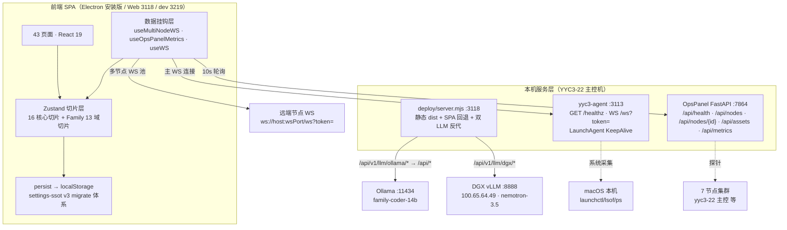
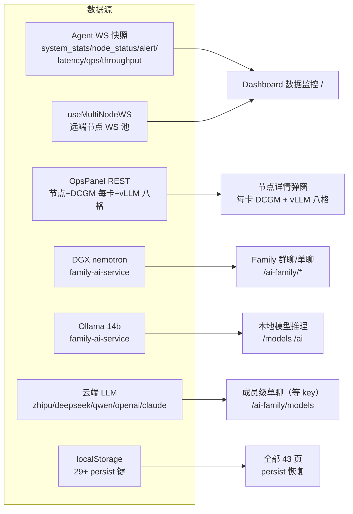
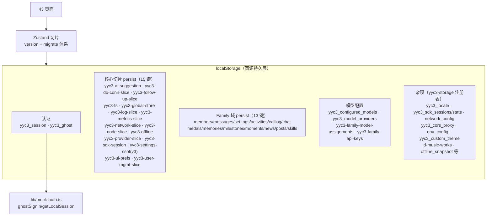

# 落档 42 · 全局深度审核 — 43 路由矩阵 · 视效统一 · 数据架构全景

> **_YYC³_**（YanYuCloudCube™ · 注册商标）
> _言启象限 | 语枢未来_
> **_Words Initiate Quadrants, Language Serves as Core for Future_**
> _万象归元于云枢 | 深栈智启新纪元_
> **_All things converge in cloud pivot; Deep stacks ignite a new era of intelligence_**

---

## 核心理念

**五高架构**：高可用 | 高性能 | 高安全 | 高扩展 | 高智能
**五标体系**：标准化 | 规范化 | 自动化 | 可视化 | 智能化
**五化转型**：流程化 | 数字化 | 生态化 | 工具化 | 服务化
**五维评估**：时间维 | 空间维 | 属性维 | 事件维 | 关联维

---

> 以侧栏导航七分类×43 入口为基的全局深度审核：全页面系统可用性（Playwright 逐页实证）、视效动画与字体统一性、数据架构（数据源/API 路由/存储架构）三图全景。

## 一、全局导航矩阵审计（43/43 通过）

**方法**：Playwright headless Chromium → vite dev (3219, hash 路由) → 预置 ghost 会话 → 逐路由 `location.hash` 导航 → 每页采集正文体量 / 标题 / WS 状态 / 控制台错误。

### 1.1 路由矩阵

| # | 分类 | 路由 | 页面标题 | 字数 | 判定 |
| ---- | ---- | ---- | ---- | ---- | ---- |
| 1 | 监控 | `/` | 数据监控（仪表盘） | 8622 | ✓ |
| 2 | 监控 | `/follow-up` | 一键跟进 | 537 | ✓ |
| 3 | 监控 | `/follow-up-manager` | 协同管理 | 800 | ✓ |
| 4 | 监控 | `/patrol` | 巡查仪表盘 | 194 | ✓ |
| 5 | 监控 | `/alerts` | 智能告警规则 | 210 | ✓ |
| 6 | 运维 | `/operations` | 操作中心 | 397 | ✓ |
| 7 | 运维 | `/files` | 本地文件管理 | 248 | ✓ |
| 8 | 运维 | `/host-files` | 宿主机文件系统 | 173 | ✓ |
| 9 | 运维 | `/database` | 本地数据库管理 | 205 | ✓ |
| 10 | 运维 | `/db-connections` | 数据库连接管理 | 297 | ✓ |
| 11 | 运维 | `/connection-test` | 全链路服务连接测试 | 1114 | ✓ |
| 12 | 运维 | `/loop` | 服务闭环 | 672 | ✓ |
| 13 | 运维 | `/reports` | 性能报表 | 177 | ✓ |
| 14 | 运维 | `/export-center` | 配置中心 | 329 | ✓ |
| 15 | 运维 | `/connection-monitor` | （内容区主体，无 h1/h2） | 132 | ✓ |
| 16 | AI | `/ai` | AI 辅助决策 | 180 | ✓ |
| 17 | AI | `/models` | 模型管理 | 383 | ✓ |
| 18 | AI | `/ai-diagnosis` | AI 辅助诊断 | 125 | ✓ |
| 19 | AI | `/sdk-chat` | （SDK 聊天） | 156 | ✓ |
| 20 | Family | `/ai-family` | （Family 入口页） | 302 | ✓ |
| 21 | Family | `/ai-family/home` | 夜深了…欢迎回家 | 848 | ✓ |
| 22 | Family | `/ai-family/center` | 欢迎来到 AI Family 中心 | 1125 | ✓ |
| 23 | Family | `/ai-family/models` | AI Family 大模型控制中心 | 421 | ✓ |
| 24 | Family | `/ai-family/settings` | AI Family 生态控制中心 | 463 | ✓ |
| 25 | 业务 | `/hotel` | YYC3 智慧酒店 · AI Family 控制台 | 349 | ✓ |
| 26 | 业务 | `/comm-station` | 通讯基站 | 318 | ✓ |
| 27 | 开发 | `/design-system` | YYC³ 设计系统 | 828 | ✓ |
| 28 | 开发 | `/dev-guide` | 开发实施指南 | 592 | ✓ |
| 29 | 开发 | `/theme` | 主题自定义 | 1299 | ✓ |
| 30 | 开发 | `/terminal` | 终端 | 418 | ✓ |
| 31 | 开发 | `/refactoring` | YYC3 深度代码分析 & 重构方案 | 1875 | ✓ |
| 32 | 开发 | `/architecture` | YYC3 架构审计全景 | 1024 | ✓ |
| 33 | 系统管理 | `/audit` | （审计） | 816 | ✓ |
| 34 | 系统管理 | `/users` | （用户管理） | 251 | ✓ |
| 35 | 系统管理 | `/settings` | （系统设置） | 818 | ✓ |
| 36 | 系统管理 | `/unified-settings` | 统一设置管理 | 346 | ✓ |
| 37 | 系统管理 | `/security` | 安全与性能监控 | 123 | ✓ |
| 38 | 系统管理 | `/pwa` | PWA & 离线管理 | 520 | ✓ |
| 39 | 系统管理 | `/data-editor` | 数据管理 | 201 | ✓ |
| 40 | 系统管理 | `/performance` | 性能监控 | 420 | ✓ |
| 41 | 系统管理 | `/env-config` | 环境变量管理 | 1572 | ✓ |
| 42 | 系统管理 | `/storage` | 存储管理 | 199 | ✓ |
| 43 | 系统管理 | `/config-center` | 配置中心 | 683 | ✓ |

> 43/43 渲染通过；唯一注意项：`/patrol`（194 字）与 `/security`（123 字）体量偏小——两页为**摘要卡型页面**（巡查仪表盘/安全与性能监控），主体为卡片+图表非长文本，非渲染缺陷。

### 1.2 WS 连接状态观测

`已连接` 状态文本仅在 Dashboard（`/`）与 `/database` 呈现——WS 状态指示器为页面级挂点（Dashboard 专属），其余 41 页不重复渲染全局指示器，**非一致性缺陷**（属当前设计口径，登记备查）。

## 二、视效统一审计（结论：体系统一 + 1 缺陷根修）

### 2.1 字体体系（43 页全采样）

| 字体 | 角色 | 覆盖 | 判定 |
| ---- | ---- | ---- | ---- |
| **Rajdhani** | 正文主字体 | 43/43 页 | ✓ 统一 |
| **Orbitron** | 标题字体 | 43/43 页标题元素 | ✓ 统一 |
| JetBrains Mono / ui-monospace / monospace | 代码/终端语境 | 终端页、代码块 | ✓ 语境正确 |
| Georgia | 衬线字体**选项** | 仅 `/theme` 主题自定义器字体预设（`theme-presets.ts:304` serif 预设样例） | ✓ by design（字体选项非漂移） |

**结论**：全局双字体体系（Rajdhani 正文 + Orbitron 标题）43 页零漂移；等宽字体仅出现于代码/终端语境；Georgia 为主题自定义器合法字体选项。

### 2.2 色板与控件 token（8 代表页采样）

| Token | 采样值 | 覆盖 | 判定 |
| ---- | ---- | ---- | ---- |
| 主按钮底色 | `rgba(0, 255, 136, 0.08)` | 8/8 页 | ✓ 统一 |
| 主按钮圆角 | `12px` | 8/8 页 | ✓ 统一 |
| 玻璃卡片底色 | `rgba(10, 30, 60, 0.7)` | 玻璃卡组件 | ✓ 统一 |
| 标题字体 | Orbitron | 8/8 页 | ✓ 统一 |

**结论**：主按钮（底色+圆角）、玻璃卡片、标题字体在 8 个代表页（`/` `/models` `/ai-family/models` `/settings` `/design-system` `/terminal` `/hotel` `/storage`）完全统一。

### 2.3 缺陷根修：`//yyc3-icons` 协议相对 URL（`9bd8725`）

**现象**：`/sdk-chat` `/theme` `/settings` 三页出现 `GET http://yyc3-icons/macOS/64.png` DNS 解析失败（ERR_NAME_NOT_RESOLVED，合计 8 请求失败）。

**根因**：`YYC3LogoSvg.tsx` 的 `BASE = import.meta.env.BASE_URL` 拼接 `…/yyc3-icons/…`——dev/Pages 构建下 BASE_URL=`/` → 拼出 `//yyc3-icons/...` **双斜杠协议相对 URL** → `yyc3-icons` 被浏览器当主机名解析 → DNS 失败。Electron（BASE_URL=`./`）不受影响（批5修复语义），即 Web/HTTP 源一直带伤。

**根修**：仅剥尾部斜杠（`/`→空 产出 `/yyc3-icons/...` http 源正确；`./`→`.` 产出 `./yyc3-icons/...` Electron file:// 语义保持），两条链语义均不变。

**实证**：修复后三受影响页失败请求 8→0。

## 三、数据架构全景（三图）

### 3.1 分层架构总图

### 3.2 数据源 → 消费页面映射

### 3.3 存储架构图

**层级**：UI → Zustand 切片 → persist(version+migrate) → localStorage；Agent 侧 `~/.yyc3-cloud-matrix/agent-token`；OpsPanel 为独立 Python 进程（内存+探针）。

### 3.4 API 路由表（实测）

| 端口 | 服务 | 路由 | 上游/行为 |
| ---- | ---- | ---- | ---- |
| 3118 | deploy/server.mjs | `OPTIONS *` | CORS 预检 204 |
| 3118 | deploy/server.mjs | `/api/v1/llm/ollama/*` | → `localhost:11434/api/*` 反代 |
| 3118 | deploy/server.mjs | `/api/v1/llm/dgx/*` | → `PMO_DGX_URL`（100.65.64.49:8888）反代 |
| 3118 | deploy/server.mjs | `/*` | dist 静态 + SPA 回退 index.html |
| 3113 | yyc3-agent | `GET /healthz` | `ok:true + clients≥1` |
| 3113 | yyc3-agent | `WS /ws?token=` | WSMessage 协议 9 消息型 |
| 7864 | OpsPanel | `/api/health` `/api/nodes` `/api/nodes/{id}` `/api/assets` `/api/metrics` | 7 节点探针 + DCGM + vLLM |
| 8888 | DGX vLLM | `/v1/models` `/v1/chat/completions` | nemotron-3.5（经 3118 反代可达） |
| 11434 | Ollama | `/api/tags` `/api/chat` | family-coder-14b |
| 3218/3219 | vite dev | `/api/v1/llm/ollama → :11434` | dev 代理 |

**WSMessage 协议 9 消息型**（agent ↔ 前端，双侧枚举一致）：`system_stats` / `node_status` / `alert` / `latency_update` / `qps_update` / `throughput_history` / `heartbeat_ack` / `dir` / `file`。

## 四、缺陷登记与定性

| # | 现象 | 定性 | 处置 |
| ---- | ---- | ---- | ---- |
| 1 | 三页 `//yyc3-icons` DNS 失败 | **真实缺陷**（BASE_URL 尾斜杠拼接） | `9bd8725` 根修 + 8→0 实证 |
| 2 | Georgia 字体出现在 /theme | 非缺陷（主题自定义器衬线字体选项） | 无需处置 |
| 3 | WS 状态文本仅 2 页呈现 | 非缺陷（Dashboard 专属挂点设计） | 登记口径 |
| 4 | /patrol /security 体量小 | 非缺陷（卡片型页面） | 登记口径 |
| 5 | i18n enterApiKey×2 | 非缺陷（UI 文案误报，Mimosa high 提示历史定性） | 不改 |

---

## 变更历史

| 版本 | 日期 | 变更内容 | 作者 |
| ---- | ---- | -------- | ---- |
| v1.0.0 | 2026-11-17 | 初始版本 — 43 路由矩阵 + 视效统一 + 数据架构三图 + DNS 根修 | YYC³ Team |

---

  <b>YYC³</b>（YanYuCloudCube™ · 注册商标） 
  言启象限 | 语枢未来 
  <i>Words Initiate Quadrants, Language Serves as Core for Future</i> 
  万象归元于云枢 | 深栈智启新纪元 
  <i>All things converge in cloud pivot; Deep stacks ignite a new era of intelligence</i> 
  © 2026 YanYuCloudCube™（YYC³）· <a href="mailto:admin@0379.email">admin@0379.email</a>

